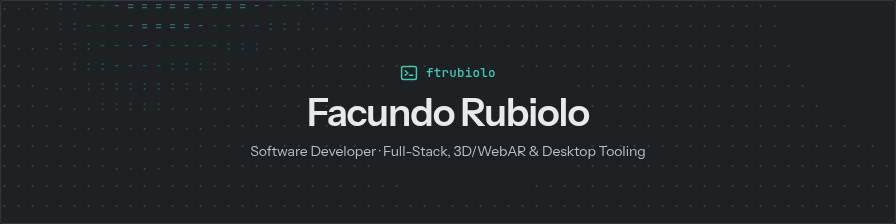
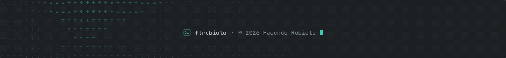

  

  
  
  
  

 

Software developer in **Córdoba, Argentina**, studying *Tecnicatura Superior en Desarrollo de Software* at **Instituto Superior Villa del Rosario (ISVR)**.  
Building end-to-end products across **full-stack TypeScript** web platforms, real-time **3D/WebAR** experiences, and **desktop tooling** with Electron and React.

- **3D Web & Desktop** — Real-time PBR viewports, app-less mobile WebAR (`USDZ` / `GLB`), binary glTF optimization, and Electron workbenches.
- **Full-Stack & Commerce** — React 19 + TypeScript UIs backed by Fastify v5, Supabase / PostgreSQL with RLS, Drizzle ORM, and Mercado Pago.
- **Tooling & Automation** — Native Sharp texture & ORM packing, Zod-validated IPC & shared contracts, MCP agents, Gemini RAG, and Docker Compose.

  

### What I've Built

#### [Sera Muebles](https://seramuebles.ar) — Contemporary Furniture E-Commerce & 3D/WebAR
> `Production · 2026` · [Live Storefront ↗](https://seramuebles.ar) · [Case Study ↗](https://ftrubiolo.github.io/projects/seramuebles)

Production storefront and operational backoffice in Córdoba, Argentina, modeling made-to-order furniture under a slot-based customization system mapped directly to workshop finish libraries.

- **Interactive 3D & App-less WebAR**: Real-time React Three Fiber PBR viewport across woods, fabrics, and metals, with QR desktop handoff, Apple Quick Look (`.usdz`), and Google Scene Viewer (`.glb`).
- **In-Browser glTF/GLB Optimizer**: Custom binary parser (`glbOptimizer.ts`) that downscales heavy textures and sanitizes discontinuous UV attributes or unsupported extensions for mobile AR.
- **Atomic Checkout & Backoffice**: Server-authoritative Deno Edge Functions (`create-checkout`, `payment-webhook`) with HMAC-verified Mercado Pago checkout, PostgreSQL + RLS (`26` tables), and an `/admin` Atelier console (`152` TS/TSX files, `25+` routes).

#### [Mirage](https://github.com/ftrubiolo/mirage) — 3D Staging & PBR Material Workbench
> `Open Source · 2026` · [Repository ↗](https://github.com/ftrubiolo/mirage) · [Case Study ↗](https://ftrubiolo.github.io/projects/mirage)

Standalone Electron 34 desktop application for inspecting glTF 2.0 assets, authoring physical materials in real time without round-tripping through heavy DCC suites, and exporting production Web/AR bundles.

- **Single WebGL Context & Zero-Recompile Uniforms**: Live slider updates mutate `MeshPhysicalMaterial` uniforms directly without triggering shader recompilations.
- **Strict Trust Boundary**: Isolated Main / typed Preload (`45` methods) / Renderer architecture with `fs.realpath` allowlists and `44` Zod-validated IPC channels.
- **Native Asset Pipeline & AI Studio**: Asynchronous `.webp` thumbnails and multi-threaded ORM channel packing (`R=AO, G=Roughness, B=Metalness`) via `sharp`, `.glb` live reload via `chokidar`, an MCP / OpenAI-compatible Agent Studio with Human-in-the-Loop approval & `safeStorage` vault, and **`589` passing Vitest tests** (`31` suites, `~48k` lines of TypeScript).

#### [VetVault](https://github.com/ftrubiolo/proyecto-vet-pp) — Veterinary Clinic Management Monorepo
> `Open Source · ISVR Team · 2026` · [Repository ↗](https://github.com/ftrubiolo/proyecto-vet-pp) · [Case Study ↗](https://ftrubiolo.github.io/projects/vetvault)

Comprehensive clinical and scheduling platform built as a 4-person final team project for *Prácticas Profesionalizantes I (2026)* at **ISVR**.

- **Typed Monorepo & Containerized Stack**: `3` npm workspaces (`@vetvault/shared`, Fastify v5 + Drizzle ORM + PostgreSQL 16 API, React 19 + Vite 8 + Tailwind CSS v4 frontend) orchestrated across `4` Docker Compose services.
- **Clinical Workflows & Domain Integrations**: Pet medical charts, generated PDF prescriptions (`pdfmake`), MinIO/S3 attachment storage, Colegio de Veterinarios de Córdoba license validation, SENASA catalog lookup, and Mercado Pago Checkout Pro billing.
- **RAG Clinical Copilot**: Rate-limited Gemini (`@google/generative-ai`) assistant grounded in patient medical history with role-based call quotas.

  

### Technical Stack

  

| Area | Technologies |
| :--- | :--- |
| **Languages & Frontend** | TypeScript, React 19, JavaScript, Astro, Tailwind CSS v4, Zustand, Vite |
| **3D Web & Desktop** | Three.js, React Three Fiber, glTF 2.0 / PBR, WebAR (`USDZ` / `GLB`), Electron, Sharp |
| **Backend & Data** | Node.js, Fastify v5, PostgreSQL, Supabase (+ RLS & Edge Functions), Drizzle ORM, SQLite, MinIO / S3 |
| **Quality, Infra & APIs** | Vitest, Zod, Docker, Git, GitHub Actions, Mercado Pago, Gemini AI, MCP |

---

### Background

- **Education**: *Tecnicatura Superior en Desarrollo de Software* — Instituto Superior Villa del Rosario (ISVR) *(in progress)*
- **Languages**: Spanish *(Native)* · English *(Technical reading & documentation)*
- **More**: Full case studies and downloadable CV at **[ftrubiolo.github.io](https://ftrubiolo.github.io)**

  

